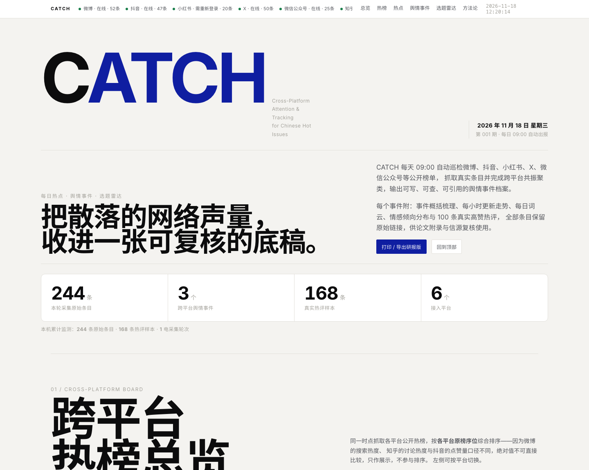

# CATCH · 跨平台热点与舆情事件监测系统

> **C**ross-platform **A**ttention & **T**racking for **C**hinese **H**ot issues
> 面向新闻与传播研究者的每日热点 · 舆情事件 · 选题雷达。

CATCH 每天自动巡检微博、抖音、小红书、X、知乎、新闻等 **6 个公开信源**，
抓取**真实条目**，完成跨平台共振聚类，输出可直接用于课程作业 / 论文选题的舆情事件档案。

### 🌐 在线访问

**<https://sylviawwforever.github.io/catch/>**

固定链接，任何人打开都能看到最新一期。采集与发布由 **GitHub Actions 在云端**完成
（每天自动完整采集一次 + 每小时增量），不依赖任何一台本地电脑，关机也照常更新。



---

## 一、它解决什么问题

新闻与传播方向的研究者每天面对的真实困境是：信息太散、口径不一、无法复核。
CATCH 把「散落的网络声量」收进一张**可复核的底稿**：

| 你要的东西 | CATCH 的产出 |
|---|---|
| 今天有什么热点 | 跨平台热榜总览（可按平台切换），热点「话题与梗」——**只抓文字条目**，不采视频 |
| 什么正在成为舆情事件 | 跨平台共振聚类出的事件档案：概括梳理、要素表、传播阶段 |
| 事件怎么演变的 | 每小时更新的走势图（实测点 + 模型估算基线，清晰区分） |
| 舆论在说什么 | 每日词云（jieba TF-IDF，按情感极性着色）+ 情感倾向四分（积极/中性/消极/愤怒） |
| 原话是什么 | 每个事件 **1000 条真实高赞热评**，可搜索、可分页、可一键导出 CSV |
| 我该写什么 | 选题雷达：热度 × 争议度 × 跨平台共振 × 样本充分度 的加权评分 + 角度与方法建议 |
| 现在流行什么词 | 网络流行语板块：近 7 天社交媒体热榜中被提到最多的流行语 + 释义 + 释义来源 + 提及量与覆盖平台 |

---

## 二、快速开始

### 方式 1：公网链接（推荐，无需任何本地环境）

**<https://sylviawwforever.github.io/catch/>**

这是一个固定链接，任何人打开都能看到最新一期数据。页面由 **GitHub Actions 在云端定时采集**
（每 6 小时增量、当天第一次完整采集）后自动发布，不依赖任何一台本地电脑，关机也照常更新。
把这个链接分享给别人即可。

> 公网版是只读的：页面上的「刷新数据」按钮会自动隐藏，因为数据由云端写入。
> 访客看到的内容与本地版完全一致。

### 方式 2：本地双击启动

```
双击「启动CATCH.command」
```

会自动启动本地服务器（禁用缓存）并打开浏览器 → <http://localhost:8900>
本地版保留「刷新数据」按钮，可在本机即时补采一轮。

### 方式 3：手动

```bash
cd ~/Desktop/项目/catch
python3 tools/serve.py 8900        # 启动本地服务
```

### 方式 4：直接打开文件

双击 `index.html` 也能看（图表不依赖网络），但**页面上的刷新按钮会失效**——
浏览器不允许 `file://` 页面访问本机采集服务。要用刷新功能请走方式 2/3。

---

## 三、数据从哪来（全部为真实公开数据，无模拟内容）

| 平台 | 采集入口 | 说明 |
|---|---|---|
| 微博 | tophub.today 微博热搜榜 | 原始热度值（万/亿），保留原链接 |
| 抖音 | tophub 抖音热点榜 | 话题标题与热度值（只取文字条目，不采视频） |
| 小红书 | tophub 小红书热榜；**登录后**叠加 xhs CLI（笔记 + 评论） | 见下方「解锁小红书」 |
| X | trends24.in 24 小时趋势时间线 | 逐小时快照的真实趋势条目 |
| 知乎 | tophub 知乎热榜 | 用于交叉验证与事件发现 |
| 新闻 | tophub 新闻分类：澎湃新闻 / 今日头条热榜 / 百度热搜 / 知乎日报 | 硬新闻条目，用于事件发现与议程设置分析 |
| 网络流行语 | **近 7 天公开热榜逐日归档**（GitHub 公开仓库 `iiecho1/hot_searches_for_apps` 的 `archives/`，微博 / 抖音 / 知乎 / 百度 / 今日头条，每日每平台一个 Markdown） | 语料约 3,000–3,900 条（7 天 × 5 平台）。**不引用任何年度榜单**，由系统自行归纳 |
| 流行语判定 | 结构判据 + 百度百科开放 API（类别仲裁） | 结构判据：跨 ≥2 天复现、跨 ≥2 个不同句式或 ≥2 个平台、非硬新闻语境、与「二创型标记」（教学 / 挑战 / 翻唱 / 转场 / 模仿 / 玩法）共现。百科仲裁：`desc` 判为网络流行语 / 网络用语 → 采纳并引百科释义；判为人物 / 机构 / 地名 / 普通词义 → 剔除；无词条 → 视为新词，依真实热榜语境归纳 |
| 流行语释义 | 百度百科开放 API | 释义、类别与摘要；百科无词条时由本轮据真实热榜语境归纳，页面逐条标注释义来源 |
| 哔哩哔哩 | 搜索 API + 公开评论接口（mode=3 热度排序 + 二级回复） | **真实高赞热评**来源（只取评论文本，不取视频条目） |

### 解锁小红书真实笔记与评论（可选，一次即可）

公网云端需要在仓库的 GitHub Actions Secret 中配置 `XHS_COOKIE`。
Cookie 的值只存入 GitHub Secret，不进入网页或 Git 仓库。建议使用专门的采集账号。
在 Chrome 的小红书页面打开开发者工具，进入「网络」，点开任意小红书请求，
在「标头 → 请求标头」中找到 `Cookie`，复制它的整行值作为 Secret 内容。
不要把 Cookie 发到聊天、写入代码或提交到 GitHub 文件。

在仓库进入：

```text
Settings → Secrets and variables → Actions → New repository secret
Name: XHS_COOKIE
Value: Cookie 请求头的完整值
```

本地采集也可以直接从已登录浏览器提取：

```bash
xhs login          # 会打开浏览器流程，或从已登录的 Chrome 提取 Cookie
```

配置后下一轮 GitHub Actions 会安装 `xiaohongshu-cli`，将 Secret 转成仅云端可读的
`~/.xiaohongshu-cli/cookies.json`，再由 `tools/collect.py` 叠加真实笔记与评论。
状态条上的小红书指示灯会由「需重新登录」变为「在线」。Cookie 失效时会自动回到
公开热榜，并在页面显示降级状态。

---

## 四、每天怎么更新

系统有**三套更新链路**，共享同一套采集代码（`tools/collect.py`），口径完全一致：

| 链路 | 载体 | 触发 | 作用 |
|---|---|---|---|
| **云端主链路** | GitHub Actions + GitHub Pages | 北京时间 01:00 / 07:00 / 13:00 / 19:00 触发；当天第一次自动完整采集，其余为增量 | 不依赖任何一台本地电脑，关机也照跑；产出直接发布到公网链接 |
| **本地采集链路** | macOS launchd | 每天 09:00 完整采集；每小时整点增量 | 本机可用时的即时补采，也是开发调试入口 |
| ~~本地发布链路~~ | ~~macOS launchd~~ | — | 已停用：公网内容完全由云端产出，避免两条链路互相覆盖 |

链路之间调用的是同一套采集代码（`tools/collect.py`），口径完全一致。
公网链接 <https://sylviawwforever.github.io/catch/> 始终呈现**云端最近一轮**的真实数据。
页面打开和点击「刷新云端数据」都会带时间戳重新读取最新发布快照；如果某一平台失败，
页面会显示失败/降级状态，不会把旧数据伪装成在线数据。期号从 2026-11-21 起为
「第 001 期」，之后按采集日自动递增，同一天的小时更新沿用当天期号。

> 早期还挂过一条「本地发布链路」（launchd `com.catch.publish`，每小时把本机结果推上去），
> 现在**已停用**：它会与云端争夺同一个 `gh-pages` 分支，导致分享出去的链接内容
> 在「本地数据」与「云端数据」之间来回跳。`tools/publish.py` 保留为手动工具——
> 需要临时把本地一轮结果发到公网时执行 `python3 tools/publish.py` 即可。

### 手动命令

```bash
cd ~/Desktop/项目/catch

# 完整采集（热点 + 事件 + 热评 + 流行语）
python3 tools/collect.py --events 5 --comment-target 1000

# 只刷新每小时走势快照（约 40 秒）
python3 tools/collect.py --hourly

# 把 JSON 装配成前端可加载的 data.js
python3 tools/build_site.py
```

### 云端主链路：GitHub Actions + GitHub Pages

工作流定义在 `.github/workflows/publish.yml`：

1. **触发**——`schedule` 设为 `0 17,23,5,11 * * *`（UTC，即北京时间 01:00 / 07:00 / 13:00 / 19:00）触发一次，
   也可在 Actions 页面手动 `workflow_dispatch` 触发；
   每次都调用 `collect.py --hourly`，由脚本内部的 `lastFullRun` 判断决定这一轮是**完整采集**还是**增量采集**
   ——今天还没做过完整采集就自动升级为完整采集（保证「打开就是当天」），今天做过了就只实测热度、
   追加走势点。这样 cron 只需一条规则，不必在表达式里区分两种模式；
2. **采集**——在 `ubuntu-latest` 上执行 `tools/collect.py` 与 `tools/build_site.py`；
   运行器在美国机房，访问 tophub.today、trends24 等源站的成功率比国内网络更高；
3. **回写**——把 `meta.json` / `events.json` / `history.json` / `hotspots.json` /
   `data.js` 与热评样本提交回源仓库，让下一轮增量采集能读到上一期的
   `lastFullRun`，从而正确判断「今天是否已完整采集」；
4. **发布**——把 `index.html`、`assets/css`、`assets/js`、`assets/data/comments/`
   推送到 `gh-pages` 分支，GitHub Pages 随即自动上线，链接永久不变。

公网版本的「刷新云端数据」会真实重新读取云端最新快照；由于 GitHub Pages 是静态站点，
它不会把 GitHub 写权限放进访客浏览器，因此按钮不会绕过云端任务直接启动一次采集。
本地版（`localhost`）的「刷新数据」则会真实启动本机采集、等待完成并重载页面。
如果需要公网按钮直接触发云端采集，需要另配一个受保护的后端/Cloudflare Worker，
不能把 GitHub Token 放进前端。

### 本地备链路：macOS launchd

定时采集由**系统级 launchd 任务**执行（配置在 `~/Library/LaunchAgents/`）：

| 任务 | 时间 | 做什么 |
|---|---|---|
| `com.catch.daily` | 每天 **09:00** | 完整采集（8 平台热榜 + 每事件 1000 条真实热评 + 流行语）+ 装配。若撞上正在运行的小时任务，会**排队等待最多 2 小时**而不是直接放弃 |
| `com.catch.hourly` | 每小时整点 | 增量采集：实测热度并追加走势实测点 + 装配 |

为什么不用 MiniMax Code 的定时任务跑采集：2026-11-20 实测，Agent 定时任务在
内容安全审核接口（`agent.minimax.io`）传输超时后整轮中止——任务被「投递」了，
但一个命令都没执行，页面因此停留在前一天。launchd 直接跑 Python，
不经过模型与审核链路，只要机器开着且已登录就会执行；错过了时间点，
会在唤醒后补跑。

```bash
# 查看任务状态
launchctl list | grep catch
# 手动触发一次完整采集（等价于点页面上的「刷新数据」）
cd ~/Desktop/项目/catch && python3 tools/run_refresh.py full
# 重新装载配置（改过 plist 后）
launchctl bootout gui/$(id -u)/com.catch.daily
launchctl bootstrap gui/$(id -u) ~/Library/LaunchAgents/com.catch.daily.plist
```

> **为什么 daily 必须等待而不是跳过**：2026-11-21 实测，09:00 的完整采集撞上了
> 正在运行的小时增量，被互斥锁直接放弃（退出码 2），导致当天**一次完整采集都没做成**，
> 页面停留在前一天的残缺数据。互斥锁本意是防止两个采集同时写坏数据，
> 但「直接放弃」和「排队等待」解决的是同一个冲突，后果差别很大。

Agent 侧的每日任务保留为 **09:20**，职责只剩一件事：为已经采好的事件
**撰写分析层**（概括梳理、传播阶段、研判要点、选题角度），然后重新装配。
采集不归它管，两者互不冲突；Agent 侧不可用时，数据依然是当天的，
只是新事件暂时只有自动生成的要素表。

小时级增量**不重新聚类**：它沿用当日 09:00 选定的 5 个事件与触发条目，
只按当前榜单实测各事件的实时热度并追加走势实测点。榜单会随时间轮换，
若小时任务重新聚类，事件身份会漂移（9 点的第 2–5 号事件到下午可能已跌出榜单，
同时冒出新话题），当日的热评样本与分析层会被整体冲掉。事件跌出全部榜单时，
该小时的实测热度记为 0——这是真实测量而非估算。
另有一道兜底：若小时增量发现「今天还没做过完整采集」（09:00 那轮失败），
它会自动升级为完整采集，避免页面一直停在昨天。

### 页面上的「刷新数据」按钮（仅本地版）

报头右侧的 **刷新数据** 按钮会真的在本机跑一遍采集：

1. 浏览器 `POST /api/refresh` → 本地服务器（`tools/serve.py`）拉起
   `tools/run_refresh.py full`，独立进程运行，不阻塞页面；
2. 页面每 3 秒轮询 `/api/refresh/status`，按钮上显示「刷新中 · 已运行 X 分 Y 秒」
   与最近一行采集日志；
3. 采集与装配完成后页面自动重载，就是最新一期；
4. 同一时刻只允许一个采集进程（定时任务与手动点击互斥），
   重复点击只会提示「采集已在运行中」。

完整采集耗时约 5–20 分钟（热评命中缓存时更快，首次抓取或被 B 站限流时更久）。

> **必须通过 `http://localhost:8900/index.html` 打开**。直接双击 `index.html`
> （`file://` 协议）页面能正常显示，但浏览器禁止 `file://` 页面访问本机服务，
> 点刷新键只会得到「无法连接本地采集服务」——那是协议限制，不是服务挂了。

---

## 五、目录结构

```
项目/catch/
├── index.html                 # 页面骨架（语义化结构 + 打印版式）
├── 启动CATCH.command          # 一键启动
├── .github/workflows/
│   └── publish.yml            # 云端定时采集 + 自动发布（GitHub Actions）
├── assets/
│   ├── css/catch.css          # 设计系统（单一深海军蓝强调色、发丝线、无阴影）
│   ├── js/app.js              # 渲染引擎：手写 SVG 走势图 / Canvas 词云 / 交互
│   ├── js/data.js             # ⚙️ 自动生成，勿手改
│   └── data/                  # 原始数据层
│       ├── hotspots.json      # 热点榜（文字条目）+ 榜单排序 + 共振词 + 网络流行语
│       ├── events.json        # 舆情事件（含热评、情感、词云、走势）
│       ├── analysis.json      # 分析师撰写层（概括梳理 / 研判 / 选题角度）
│       ├── history.json       # 每小时走势历史（实测点累积）
│       ├── comments_cache.json# 热评跨轮次缓存（累积至每事件 1000 条）· 不入库
│       ├── comments/          # 完整热评样本（每事件一个 JSON，按需加载）
│       ├── meta.json          # 采集元信息（平台状态、耗时、条目数、lastFullRun）
│       └── refresh_status.json# 采集进度状态（页面「刷新数据」按钮轮询这个文件）
└── tools/
    ├── collect.py             # 采集管线（跨平台共振聚类 + 情感 + 词云 + 走势）
    ├── build_site.py          # 数据装配器（合并分析层 → data.js）
    ├── run_refresh.py         # 采集执行器（互斥锁 + 排队等待 + 进度状态）
    └── serve.py               # 本地服务器（禁用缓存 + /api/refresh 刷新接口）
```

---

## 六、关键算法

**跨平台共振聚类** —— 只有当同一实义实体在**两个及以上平台**同时出现，才判定为舆情事件。
匹配时使用低文档频率（IDF 过滤）的实义 token（中文 ≥3 字 / 西文 ≥3 字符），
排除「网友 / 回应 / 官方 / 视频」等通用词，避免"美"字级误合并。
泛词表同时覆盖疑问句式（`怎么办 / 好不好 / 有没有`）与英文缩写
（`app / api / ai / pdf`）——这类词既当不了事件名，也不该作为聚类合并依据：
早期版本未排除时，「比亚迪 App 崩了」与「App 下载」被并为一簇、
「医生以商人观念治病」与「杨超越太阳雨戒断反应」被误并，
事件关键词退化成「App」「怎么办」，导致检索召回大量无关内容、标题闸门失效。

**情感判定** —— 规则法：情绪词典 + 程度副词加权 + 否定词翻转，
输出积极 / 中性 / 消极 / 愤怒四类占比。词典与阈值见 `tools/collect.py` 顶部常量区，可自行调参。

**词云** —— jieba TF-IDF 提取，词权重映射字号，颜色按情感极性编码
（深海军蓝 = 积极，黑色 = 中性，信号红 = 消极 / 愤怒）。

**走势模型** —— 实测点来自每小时真实采集；实测点不足 6 个时，
用扩散模型（早期爬升 + 后期指数衰减）补齐 24 小时基线，空心点为估算、实心点为实测，
图例中明确标注，不混淆二者。

**选题雷达** —— 热度 ×0.30 + 争议度 ×0.28 + 跨平台共振 ×0.24 + 样本充分度 ×0.18。

**基础数据量（页面内已逐项标注）** —— 以最近一轮采集为例：

| 面板 | 底层数据量 |
|---|---|
| 跨平台热榜 | 8 个平台 400 条原始条目 |
| 舆情事件 | 每日至多 5 个跨平台共振事件（仅当同一实义实体在 ≥2 个平台同时出现时成立；实测不足 5 个则如实少出） |
| 每日词云 | 对应事件的真实热评（本期 4,000 条）参与 jieba TF-IDF |
| 舆情走势 | 每小时一个实测点（本期 20 个），实测点不足 6 个时用扩散模型补齐 24 点基线，空心为估算 |
| 真实热评 | 每事件目标 1,000 条，按点赞热度排序取样（非全量抓取），可在页内一键载入完整样本；采集端与装配端统一用「标题含关键词 或 与触发条目共享 ≥4 字连续片段」判定相关性，并在页面标注比例 |
| 网络流行语 | 5 条，语料为近 7 天 5 平台公开热榜逐日归档（本期 3,519 条），经结构判据筛出候选、再由百度百科逐词仲裁后收录 |

---

## 七、学术使用注意

- 仅采集公开可见内容，不执行任何账号操作，不做个人信息再识别。
- 每条热评保留原平台链接，导出 CSV 时附带来源 URL，便于附录引用与信源复核。
- 平台热度口径不一（微博为搜索热度、抖音为点赞、B站为播放），
  **跨平台绝对值不可直接比较**，建议以序位与结构比较为主，方法论页已明示。
- 走势图的模型估算点仅用于首日展示，随实测累积逐步替换；论文引用请注明点位类型。
- 引用格式见页面「方法论」板块。

---

## 八、已知限制（如实说明）

1. **小红书**：`xhs login` 前只能取到公开热榜，取不到笔记与评论；状态条会标「需重新登录」。
2. **哔哩哔哩评论接口有频率限制**：短时间内大量抓取会触发反爬（返回 HTML 而非 JSON）。
   系统已内置节流、熔断与**跨轮次缓存**（`assets/data/comments_cache.json`），
   被限流时保留历史样本而不丢数据，逐日累积至每事件 1000 条。
   2026-11 起 B 站 web 接口要求 **WBI 签名**（`w_rid`）：未签名的 `/x/v2/reply/main`
   会返回反爬 HTML 或 `-403 访问权限不足`；系统已改为从 `nav` 接口取 img_key/sub_key
   按官方置换表算出 mixin key 并签名，走 `/x/v2/reply/wbi/main`。
   未登录状态下每视频根评论接口仍仅返回 3 条根评论，
   需再经 `/x/v2/reply/reply` 逐条拉取二级回复，单视频产能约 12–30 条。
3. **微博 / 抖音 / 知乎评论**需登录态，本系统不触碰账号操作，因此热评样本以 B 站公开评论接口为主；
   页面每条热评都标注来源平台与原始链接，抽样边界在事件研判中也会写明。
4. **平台热度口径不可比**：微博为搜索热度、知乎为讨论热度、抖音为点赞、B 站为播放，
   故综合排序以**各平台原榜序位**为主，热度值仅展示不参与跨平台比较。
5. **走势模型估算点**：实测点不足 6 个时用扩散模型补齐 24 小时基线，
   图例明确区分空心点（估算）与实心点（实测），随每小时采集逐步替换。
7. **热评样本为热度排序取样，且存在相关性问题**：1000 条样本按点赞热度排序获取，**并非全量抓取**；
   平台未公开的评论不可得，结论不应外推至全网。每条样本均保留原始链接。
   更关键的是：B 站评论按「事件关键词检索到的视频」取样，检索会召回标题与事件无关的
   「蹭词」视频，导致样本混入跑题评论（实测部分事件跑题比例过半）。
   本系统因此做了三道处理——
   (a) **采集端源视频标题闸门**：判据为「标题含事件关键词」或
       「标题与该事件任一触发条目共享 ≥4 字连续片段」。
       早期版本用「命中任一检索词即放行」，会把「经济体」「十二年」「外交部」
       这类**主题域泛词**当成事件特征，召回大量蹭词视频
       （罗大佑访谈、民进党科普、外交部例行记者会），实测相关率仅 24%–46%；
       改用长公共子串后，蹭词视频被系统性剔除，而真正谈到该事件的视频仍被保留；
   (b) **缓存同步过闸**：旧判据放行的蹭词条目不再复用，也不再写回缓存
       （一次清理剔除 10,236 条、保留 5,192 条）；
   (c) **装配端逐条测算相关性**：与采集端用同一把尺子（关键词命中 或
       与触发条目共享 ≥4 字连续片段），并在页面上标注每事件的相关条数与比例，
       提供「只看相关」筛选与带「是否与事件相关」列的 CSV 导出。
   词云与情绪分布改用「相关且近 30 天」的评论重算（不足 30 条时逐级回落并标注口径）；
   相关样本不足 30 条时保留原值并如实标注。
   相关比例偏低的事件（< 30%）会在每日出报中被单独提示。
   仍需注意：即便过闸，样本仍来自 B 站单一平台与检索排序，
   代表性由平台机制决定，不可等同于该事件的全网舆情分布。
8. **热评样本存在时效性问题**：B 站检索会召回跨年份的旧视频（如格力历史视频、
   早年的都市话题视频），其评论不代表当期舆情——实测某事件 1000 条样本中
   近半来自 2020–2025 年。本系统因此：
   (a) 不删除任何评论，只逐条标注 `recent`（发布于「采集日 − 30 天」内）；
   (b) 页面标注每事件的近 30 天条数与比例，并提供「只看近 30 天」筛选；
   (c) 词云与情绪分布改用「相关且近 30 天」的评论重算；
   (d) 导出 CSV 增加「是否近 30 天」与「发布时间」两列。
   引用当期舆情结论时，应使用近 30 天子样本；研究长期议题时才使用全样本。
9. **Agent 侧定时任务不可作为采集保障**：2026-11-20 凌晨至中午，
    MiniMax Code 的定时任务在内容安全审核接口（`agent.minimax.io`）传输超时后整轮中止——
    任务被「投递」了，但一个命令都没执行，页面因此停留在前一天。
    采集已改由系统级 launchd 任务承担（不经过模型与审核链路）；
    Agent 侧只在 09:20 补写分析层，它不可用时数据依然是当天的，
    只是新事件暂时只有自动生成的要素表（只含事实，不含推断）。

10. **流行语为系统自行归纳，不引用年度榜单**：候选来自近 7 天各平台公开热榜逐日归档，
   先用四条结构判据（跨天复现、跨句式或跨平台复现、非硬新闻语境、与二创型标记共现）
   区分「可复用表达」与「一次性新闻事件」，再由百度百科开放 API 逐词仲裁类别。
   因此：
   (a) 「提及量」指该词在**所采集平台的热榜条目中**出现的次数，不是全网发帖量，
       平台外的讨论（小红书、微信私域、B站评论区等）未被计入；
   (b) 百度百科未收录的当红新词归为「新词」，释义由本轮据其真实热榜语境归纳，
       并在页面逐条标注「释义来源」，不等同于百科释义；
   (c) 作品衍生的梗（歌曲 / 小说 / 综艺衍生的表达）需以梗语境为主才收录，
       判定阈值较严，可能存在漏收；
   (d) 结构判据依赖关键词模板，存在把「网络热词」误判为「流行语」、
       或漏掉不含模板标记的冷门流行语的可能。
   页面与本节均标注该边界，不作权威认定。

11. **跨平台共振聚类存在两类系统性误并**（2026-11-21 实测，本轮 5 个事件各命中其一）：
   (a) **人物型关键词污染**——当一个人名同时是多个议题的共同要素时，基于实义 token 的匹配
       无法区分「同一人物的不同事件」。实测「特朗普」事件 10 条触发条目中仅 6 条真正指向
       中俄美元首会晤，另外 4 条（「高市搭讪特朗普被无视」157.4 万、「特朗普称不支持台独」
       116.6 万、「不允许美企海外建数据中心」207 万、「高市早苗吐舌头」17 万）仅共享人名，
       使该事件综合热度虚高约 9.4%；
   (b) **泛词污染**——共享 ≥4 字连续片段的判据在「意味着什么」「回应」「最新」这类
       高频泛化句式上必然失效。实测「美股一天内遭血洗意味着什么」与知乎
       「超强厄尔尼诺已经形成…这意味着什么？」被并入同一事件，使该事件热度虚高 65%
       （424 万 vs 真实 259.5 万），并使热评采样关键词被污染为「意味着」「厄尔尼诺」，
       样本实际混合了美股与气候两类内容。
   本系统的处理是**如实标注而非掩盖**：每个事件的「触发条目」要素表会区分相关与弱相关条目，
   研判要点第一条即写明误并范围与误差量级。根治需引入停用词表或提高 IDF 阈值，
   当前尚未实施——因此**跨平台共振平台的个数不能直接当作事件重要性的度量**。

12. **榜单量级 ≠ 可研究程度**：短视频主导的娱乐事件在长视频评论平台上几乎没有样本。
   2026-11-21 实测「黄景瑜腿绞泰国拳王」在新闻榜第 11 位、热度 1052 万，
   但 B 站按「泰国拳」检索扫描 0 个相关源视频、跳过 75 个，**热评样本为 0 条**，
   词云与情感面板显示为空态而非零值。而同一轮「顺丰速运被暂停全军采购资格」热度仅 1362 万，
   样本却达 141 条。三个事件在研究设计中不应被等同对待。

13. **数据源会间歇性失效**：tophub.today 源站对不同 User-Agent 返回不同结果，
   同一时刻用 Chrome UA 直连与经 jina 代理均返回 503，改用 Safari UA 直连则返回 200
   （但榜单是 ajax 异步加载，初始 HTML 只有骨架，仍需经 jina 转 Markdown）。
   系统的应对是三级：① 识别 jina 返回的错误页（源站 503 会透传为 200 + 错误正文）
   并退避重试；② board 级三轮重试 + 每平台 120 秒预算上限；③ 仍失败则用
   GitHub 每日热榜归档兜底（公开、免鉴权，但**只有标题与链接、没有热度值**，
   该口径在页面标注）。因此「平台条目数为 0」可能来自源站故障而非该平台无热搜。

14. **云端链路与本地链路存在口径差异**：
   (a) GitHub Actions 运行器位于美国机房，访问 tophub.today、trends24 等源站的成功率
       与国内网络不同，两条链路的单轮产出可能不完全一致；
   (b) 云端的热评与百科释义缓存通过 Actions cache 跨轮保留，**本地链路的
       `comments_cache.json` 不入库**，两条链路的样本累积进度彼此独立；
   (c) 云端发布的是 `gh-pages` 分支的构建产物，本地版本地运行，二者的数据可能相差一轮；
   (d) 小红书 CLI 登录态无法带到云端，因此**公网版的小红书只有公开热榜、没有笔记与评论**，
       本地版在 `xhs login` 后可叠加。这是两条链路唯一的能力性差异。

---

## 九、设计系统

参考 *PencilBooth* 的编辑型报纸（broadsheet）语言，并做了三处升级：

1. **更暖的纸感**：画布 `#f4f3f0`，卡片纯白，靠表面反差而非阴影制造层次；
   全站 1px 发丝线 `#e2e0da` 作为唯一边界语言。
2. **更克制也更有力的字级**：96px 级 section display 与 16px 正文形成 6 倍落差，
   字距统一 0.01em，字重只有 400 / 700 两档。
3. **唯一例外是数据语义色**：情感分布与风险等级需要语义编码，
   因此引入 `#b3261e`（信号红），**仅**用于负面数据与高危标识，绝不用于装饰。

图表全部手写（SVG 折线 / Canvas 词云），无任何 CDN 依赖，断网可完整呈现。
